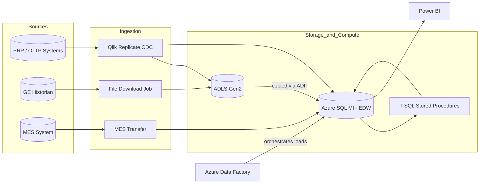
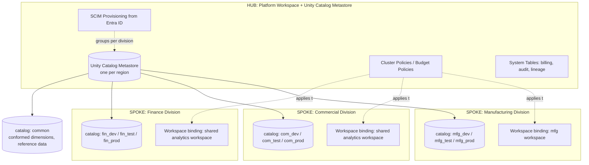
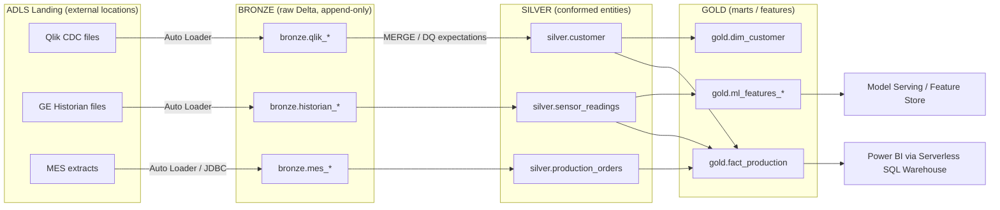
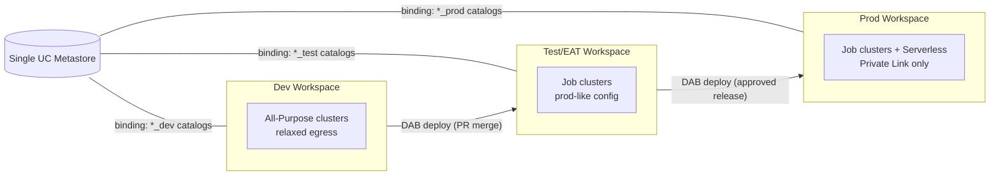
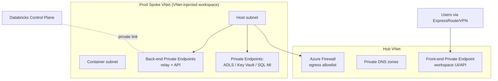
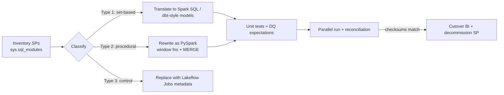
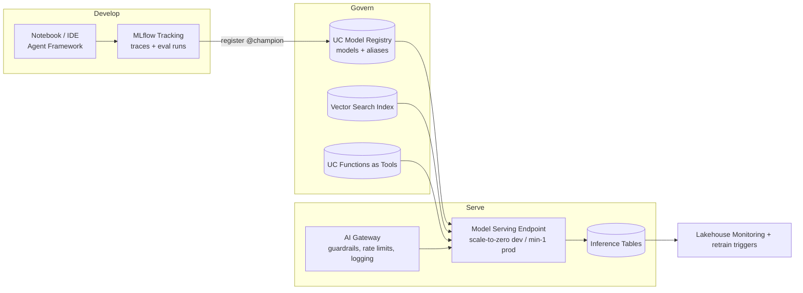
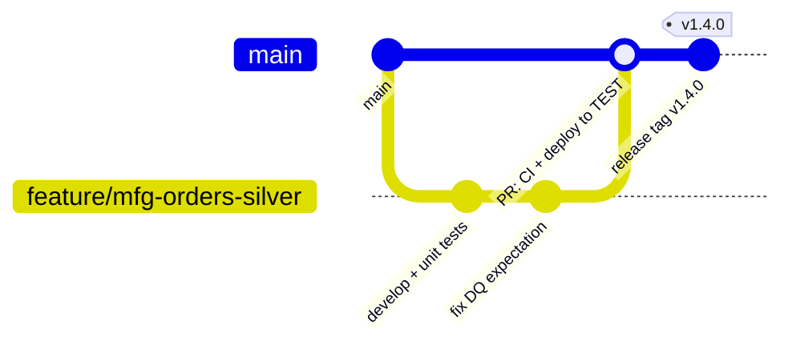

# Azure Databricks Enterprise Implementation — Technical Project Plan

**Version:** 1.0 · **Status:** Proposed · **Audience:** Data Engineering, Platform Engineering, Security, BI, and ML teams
**Owners:** Principal Data Architect · Platform Lead · DataOps PM

> This plan describes the migration of a multi-division organization from a SQL MI–centric EDW (Qlik Replicate + ADF + T-SQL stored procedures) to a lakehouse architecture on Azure Databricks governed by Unity Catalog, with a zero-trust network posture, automated CI/CD via Azure DevOps, and an MLOps/GenAI track.

---

## Table of Contents

1. [Current State & Background Context](#1-current-state--background-context)
2. [Target Architecture: Hub-and-Spoke with Unity Catalog](#2-target-architecture-hub-and-spoke-with-unity-catalog)
3. [Medallion Architecture: Bronze / Silver / Gold](#3-medallion-architecture-bronze--silver--gold)
4. [Environment Strategy: Workspaces vs. Catalogs](#4-environment-strategy-workspaces-vs-catalogs)
5. [Security, Identity & Network Compliance (Zero Trust)](#5-security-identity--network-compliance-zero-trust)
6. [ETL Migration Path: SQL MI Stored Procedures → Databricks](#6-etl-migration-path-sql-mi-stored-procedures--databricks)
7. [Cost Optimization & Pipeline Automation](#7-cost-optimization--pipeline-automation)
8. [BI & Reporting Layer (Power BI)](#8-bi--reporting-layer-power-bi)
9. [MLOps & Generative AI Architecture](#9-mlops--generative-ai-architecture)
10. [CI/CD & Branching Strategy](#10-cicd--branching-strategy)
11. [Agile Project Structure (ADO Work Item Hierarchy)](#11-agile-project-structure-ado-work-item-hierarchy)
12. [References & Assets](#12-references--assets)

---

## 1. Current State & Background Context

| Domain | Current Implementation | Key Pain Point |
|---|---|---|
| CDC Ingestion | Qlik Replicate → ADLS Gen2 + Azure SQL MI | Dual landing zones; no unified governance |
| Historian Ingestion | GE Historian exports downloaded to ADLS | File-drop pattern; no schema enforcement or lineage |
| MES Ingestion | MES → SQL MI direct load | Tightly coupled to the warehouse; hard to reuse raw data |
| Orchestration | Azure Data Factory pipelines | Orchestrates *movement*, but transformation logic lives elsewhere |
| Transformation | T-SQL stored procedures on SQL MI | Vertical scaling ceiling, no Spark parallelism, weak lineage/testability |
| CI/CD | Azure DevOps pipelines (maturing) | Stored procedures are hard to unit test and promote |

### Current-State Data Flow



**Why change:** the SQL MI EDW is both the compute engine and the serving layer. Every new division multiplies stored-procedure sprawl, contends for the same vCores, and inherits no data lineage. The lakehouse decouples storage (ADLS + Delta Lake) from compute (elastic Spark / Serverless SQL), and Unity Catalog provides one governance plane across all divisions.

---

## 2. Target Architecture: Hub-and-Spoke with Unity Catalog

### 2.1 The Core Design Decision: Workspaces per Division vs. Unity Catalog Isolation

| Dimension | Option A: Workspace per Division | Option B: Shared Workspaces + Unity Catalog Isolation (Recommended) |
|---|---|---|
| Isolation | Hard boundary (separate control-plane objects, clusters, notebooks) | Logical boundary via catalogs, schemas, and workspace-catalog *bindings* |
| Governance | Fragmented — permissions duplicated per workspace | Centralized — one metastore, one grant model, one lineage graph |
| Onboarding cost | High: new VNet subnets, Private Link endpoints, SCIM config, CI/CD targets per workspace | Low: create a catalog + groups + grants; optionally bind to an existing workspace |
| Cross-division sharing | Requires Delta Sharing or duplicating data | Native `GRANT SELECT ON CATALOG` or shared `common` catalog |
| Cost | More idle clusters, more platform overhead | Shared cluster policies and serverless pools amortize cost |
| When it wins | Regulatory hard-isolation (e.g., a division under ITAR/sovereign-cloud rules), chargeback at the Azure-subscription level, or radically different network requirements | Everything else |

**Recommendation (hybrid):** a small number of workspaces — one **hub** (platform/admin) plus **spoke workspaces only where a hard boundary is justified** (e.g., an OT/manufacturing spoke that must stay near plant networks, or a regulated division). All divisions get **their own catalog(s)** in a **single regional Unity Catalog metastore**. Use **workspace–catalog bindings** so a division's catalogs are only visible in the workspaces that should see them.

**The technical "why":** Unity Catalog is metastore-scoped, not workspace-scoped. One metastore per region gives you: (a) a single ANSI `GRANT` model enforced across all compute, (b) automatic column-level lineage across divisions, (c) Delta Sharing without data copies, and (d) system tables (`system.billing.usage`, `system.access.audit`) that answer chargeback and audit questions in SQL. Every extra workspace you create adds network plumbing and CI/CD targets but adds *zero* governance capability — governance lives in the metastore.

### 2.2 Hub-and-Spoke Model




**Onboarding a new division becomes a pull request**, not a project:

1. Terraform module creates: `<div>_dev/test/prod` catalogs, an external location on the division's ADLS container, Entra ID groups (`grp-<div>-readers`, `grp-<div>-engineers`, `grp-<div>-admins`), and grants.
2. Bind catalogs to the appropriate workspace(s).
3. Register the division's Qlik/ADF landing path as a Unity Catalog **external location** backed by a **storage credential** (managed identity of the Databricks access connector).
4. Clone the pipeline template repo; CI/CD targets are parameterized by catalog name.

---

## 3. Medallion Architecture: Bronze / Silver / Gold

### 3.1 Purpose of Each Layer

| Layer | Purpose | Contract | Typical Consumers |
|---|---|---|---|
| **Bronze** | Raw, immutable, append-only landing of source data (Qlik CDC files, GE Historian exports, MES extracts) converted to Delta. Preserves full history for replay and audit. | "Exactly what the source sent, plus ingestion metadata (`_ingest_ts`, `_source_file`, `_qlik_operation`)." Schema is permissive (`rescued_data` column via Auto Loader). | Data engineers only |
| **Silver** | Cleansed, deduplicated, conformed entities. CDC merged into current-state tables (`MERGE INTO`), data-quality expectations enforced, keys standardized across divisions. | "Validated, queryable entities with enforced schema and DQ expectations." | Engineers, data scientists, some analysts |
| **Gold** | Business-level aggregates, star schemas, and feature tables — the replacement for today's EDW marts built by stored procedures. | "Consumption-ready. Optimized for BI and ML serving." | Power BI, ML feature pipelines, downstream apps |

**Why three layers:** it decouples *ingestion cadence* from *business logic*. Bronze lets you replay history when logic changes (impossible when a stored procedure overwrote the target). Silver gives every division a canonical entity layer so Gold marts are cheap to rebuild. Failures are isolated per layer, which is what makes the ADO CI/CD story testable.

### 3.2 Compute per Layer

| Layer | Recommended Compute | Why |
|---|---|---|
| Bronze | **Jobs Compute** with Auto Loader (`cloudFiles`), or **Lakeflow/DLT serverless pipelines** for continuous CDC | Ingestion is scheduled/streaming batch work — job clusters spin up, run, terminate. Photon adds little value to pure file-append workloads, so it can be off here to save DBUs. |
| Silver | **Jobs Compute with Photon enabled**, or DLT with expectations | `MERGE INTO`, dedup, and joins are exactly the vectorized operations Photon accelerates (typically 2–4× on wide joins/aggregations, offsetting its DBU premium). |
| Gold | **Jobs Compute + Photon** for building marts; **Serverless SQL Warehouse** for serving them | Mart builds are heavy aggregation (Photon sweet spot). Serving is interactive SQL — the SQL Warehouse's result cache and instant scaling fit BI concurrency. |
| Ad-hoc / development | **All-Purpose Compute** (shared, auto-terminating, policy-restricted) | Interactive notebooks only. Never schedule production jobs on All-Purpose — it bills at a higher DBU rate and encourages long-running idle clusters. |

### 3.3 Partitioning & Layout Patterns

- **Bronze:** partition by ingestion date (`_ingest_date=YYYY-MM-DD`) — aligns with retention/vacuum policies and Qlik batch windows. For the GE Historian, partition by `plant` + `date`; time-series files are naturally date-bucketed.
- **Silver:** prefer **Liquid Clustering** (`CLUSTER BY (customer_id, event_date)`) over Hive-style partitioning for most tables — it avoids the small-file and cardinality traps of static partitions and re-clusters incrementally. Reserve explicit date partitioning for very large (>1 TB) append-heavy fact tables.
- **Gold:** star-schema facts clustered by the dominant BI filter columns (usually date + division key); dimensions are small and unpartitioned. Enable **Predictive Optimization** so `OPTIMIZE`/`VACUUM` run automatically.
- Rules of thumb: never partition a column with >10k distinct values; target ≥1 GB per partition; let `optimizeWrite` + auto-compaction handle file sizing rather than manual `repartition()`.



---

## 4. Environment Strategy: Workspaces vs. Catalogs

**Question:** *Should you have a workspace for dev, test (UAT/EAT), and prod — or just use catalogs and schemas?*

**Answer: use separate workspaces per environment (dev / test / prod), and per-environment catalogs within them.** Do **not** collapse environments into catalogs inside one workspace.

**The technical "why":**

1. **Blast radius.** Workspace-level settings — cluster policies, init scripts, workspace admins, network config, secret scopes, Repos — cannot be scoped per catalog. A single workspace means a dev misconfiguration (a permissive cluster policy, a bad init script, a leaked PAT) is instantly a prod incident.
2. **Network posture differs by environment.** Prod should have Private Link, no public ingress, and locked egress; dev usually needs looser egress (PyPI, GitHub). One workspace forces one network profile.
3. **CI/CD requires promotion targets.** Databricks Asset Bundles (DABs) deploy per *target workspace*. `bundle deploy -t prod` against a distinct workspace with a distinct service principal is the mechanism that makes ADO approvals meaningful.
4. **Identity separation.** Prod jobs run as environment-specific service principals; users get `CAN_VIEW` at most in prod. That separation is enforced cleanly at the workspace boundary.

**The catalogs still matter:** within this model, environment shows up twice — once in the workspace (compute/config isolation) and once in the catalog name (`mfg_dev`, `mfg_prod`) for data isolation. Workspace–catalog **bindings** enforce that `mfg_prod` is *only* accessible from the prod workspace, which prevents a dev cluster from ever reading prod data even if a grant is misapplied.



> **Anti-pattern to avoid:** one workspace with `dev`/`test`/`prod` *schemas* inside a single catalog. Schema-level isolation gives you no compute, network, or identity separation and makes SOX/ISO auditors unhappy for good reason.

---

## 5. Security, Identity & Network Compliance (Zero Trust)

Zero-trust principle applied to the lakehouse: **no implicit trust from network location; every access is authenticated (Entra ID), authorized (Unity Catalog), encrypted (TLS + CMK), and logged (audit system tables + diagnostic settings).**

### 5.1 Entra ID / SAML Authentication + SCIM + Unity Catalog RBAC

Databricks on Azure authenticates natively via **Entra ID (OpenID Connect/OAuth)** — no separate SAML federation to build. Implementation steps:

1. **Account-level SCIM provisioning.** Configure the *Azure Databricks SCIM* enterprise application against the **account console** (not per-workspace). Sync Entra ID groups only — never individual users — so joiner/mover/leaver flows are automatic.
2. **Group taxonomy.** Create Entra ID groups per division × role:
   - `grp-dbx-<div>-readers` → `USE CATALOG`, `USE SCHEMA`, `SELECT`
   - `grp-dbx-<div>-engineers` → above + `MODIFY`, `CREATE TABLE` on dev/test catalogs
   - `grp-dbx-<div>-admins` → catalog owner (prod changes only via CI/CD service principal)
   - `grp-dbx-platform-admins` → metastore admin (small, break-glass audited group)
3. **Map grants in code** (Terraform `databricks_grants` or SQL in a bootstrap job):

   ```sql
   GRANT USE CATALOG ON CATALOG mfg_prod TO `grp-dbx-mfg-readers`;
   GRANT SELECT ON SCHEMA mfg_prod.gold TO `grp-dbx-mfg-readers`;
   GRANT ALL PRIVILEGES ON SCHEMA mfg_dev.silver TO `grp-dbx-mfg-engineers`;
   ```

4. **Fine-grained controls** where divisions share tables: row filters and column masks (`ALTER TABLE ... SET ROW FILTER div_filter ON (division_id)`) instead of duplicating tables per audience.
5. **Service principals for automation.** One Entra ID service principal per environment (`sp-dbx-deploy-dev/test/prod`); federated credentials from ADO (workload identity federation) so **no client secrets are stored** in pipelines.
6. **Disable legacy access:** turn off PAT tokens where possible (or scope with token policies), enforce user isolation / shared access mode clusters so UC controls cannot be bypassed via cluster-scoped credentials.

### 5.2 Encryption at Rest — BYOK / Customer-Managed Keys (CMK) with Key Vault

Two independent CMK scopes must both be configured:

| Scope | What it covers | How |
|---|---|---|
| **Managed services CMK** | Control-plane data: notebook source, secrets, queries | Set `customer_managed_key` for managed services on the workspace resource |
| **Managed disks + DBFS/root storage CMK** | Compute-plane disks and the workspace root storage account | Disk encryption set + storage account CMK |
| **Data lake (your ADLS)** | All bronze/silver/gold data | ADLS storage accounts configured with CMK from Key Vault — this is where your actual data lives |

Implementation steps:

1. Create **Azure Key Vault (Premium, HSM-backed)** per environment with purge protection + soft delete enabled (both are hard requirements for CMK).
2. Create RSA 2048/3072 keys: `key-dbx-managed-services`, `key-dbx-disks`, `key-adls-data`.
3. Grant the Databricks-managed identities and the ADLS storage accounts' managed identities `Key Vault Crypto Service Encryption User` (RBAC model — avoid access policies).
4. Deploy via Terraform/Bicep so key URIs are versionless (auto-rotation picks up new versions); enable **key auto-rotation policy** (e.g., 12 months) and alert on `Microsoft.KeyVault` `NearExpiry` events.
5. Document the **revocation runbook**: disabling the key is the kill switch that renders all data cryptographically inaccessible — test it in dev.

### 5.3 Network Isolation — VNet Injection + Private Link

1. **VNet-inject every workspace** (no managed VNet): two delegated subnets (`host`/container) per workspace, sized for max concurrent cluster nodes (e.g., /23).
2. **Secure Cluster Connectivity (NPIP):** enabled — cluster nodes get no public IPs; control-plane communication is outbound-only over the relay.
3. **Front-end Private Link:** private endpoint for the workspace URL in a hub network; users reach `adb-*.azuredatabricks.net` via private DNS (`privatelink.azuredatabricks.net`). Public network access set to `Disabled` (prod) once validated.
4. **Back-end Private Link:** private endpoints from the compute subnets to the Databricks control plane (relay + REST API), removing the last public egress dependency.
5. **Data-path Private Link:** private endpoints for ADLS (`dfs`, `blob`), Key Vault, SQL MI, and Azure DevOps artifacts feed. Route all remaining egress through **Azure Firewall** in the hub with an FQDN allowlist (PyPI mirror via internal artifact feed rather than open internet in prod).
6. **No cross-division east-west trust:** divisions do not get network paths to each other's landing storage; sharing happens through Unity Catalog grants, not network access.




**Auditing:** enable UC `system.access.audit`, workspace diagnostic settings → Log Analytics, and Defender for Cloud on the storage accounts. Alert on: metastore-admin grants, external location creation, and `DENY`-worthy anomalous access patterns.

---

## 6. ETL Migration Path: SQL MI Stored Procedures → Databricks

### 6.1 Migration Strategy (Strangler Pattern)

Do not "big-bang" rewrite hundreds of procedures. Strangle the EDW one subject area at a time:

1. **Inventory & classify** every stored procedure (query `sys.sql_modules` + ADF activity references). Classify each as:
   - **Type 1 — Set-based transforms** (INSERT…SELECT, MERGE, aggregations): ~80% typically. Direct translation to **Databricks SQL / PySpark**.
   - **Type 2 — Procedural logic** (cursors, WHILE loops, dynamic SQL): rewrite as PySpark — cursors almost always collapse into window functions or `MERGE`.
   - **Type 3 — Operational/control procedures** (logging, batch control tables): replace with Lakeflow Jobs orchestration metadata + system tables; do not migrate.
2. **Land once, in Delta.** Repoint Qlik Replicate's primary target to ADLS (it already lands there) and stop the parallel load to SQL MI for migrated subject areas. Auto Loader converts Qlik's CDC files to Bronze Delta.
3. **Translate per subject area:** T-SQL → Spark SQL is largely mechanical (`GETDATE()` → `current_timestamp()`, `ISNULL` → `coalesce`, identity columns → `GENERATED ALWAYS AS IDENTITY`, `MERGE` is near-identical). Use an assisted-conversion tool (e.g., Databricks conversion tooling / BladeBridge-class converters) for bulk translation, then human review.
4. **Run in parallel & reconcile.** For 2–4 weeks per subject area, run legacy SP and new pipeline side by side; automated reconciliation notebook compares row counts, checksums (`xxhash64` over sorted columns), and key aggregates. Cut Power BI over only after reconciliation is green.
5. **Decommission** the SP and its ADF activities; ADF's role shrinks to (at most) triggering Databricks jobs, and eventually Lakeflow Jobs replaces ADF orchestration for lakehouse-internal flows.



### 6.2 Compute Selection Matrix

| Workload | Compute Type | Photon? | Notes |
|---|---|---|---|
| CDC file ingestion (Bronze) | **Jobs Compute** (or serverless Lakeflow pipeline for continuous) | Optional/off | I/O bound; smallest viable node count, autoscale 1–4 |
| Heavy joins/aggregations (Silver→Gold) | **Jobs Compute + Photon** | **Yes** | Photon's vectorized engine is built for these; benchmark, but expect net cost ↓ despite higher DBU rate |
| Streaming (Historian near-real-time) | **Jobs Compute (streaming)** or DLT continuous | Yes | Autoscaling streaming clusters; watermarking for late sensor data |
| Interactive development | **All-Purpose Compute**, shared, 30–60 min auto-terminate | Yes | Enforced by cluster policy; never for scheduled jobs |
| BI serving | **Serverless SQL Warehouse** | Built-in | See §8 |
| ML training | Jobs Compute (GPU where needed) | N/A | See §9 |
| Small/frequent jobs | **Serverless Jobs Compute** | Built-in | Eliminates 3–5 min cluster start latency for short tasks |

---

## 7. Cost Optimization & Pipeline Automation

### 7.1 Should ADO Pipelines Start/Stop Clusters Directly?

**No — this is an anti-pattern for production workloads.** The industry-standard pattern is **ephemeral job clusters** (or serverless), not externally managed cluster lifecycles.

**Why it's an anti-pattern:**

- **Job clusters already do it better.** A Databricks *job* defined with a `new_cluster` (via Asset Bundles) provisions compute at run start and terminates it at run end, atomically. An ADO task that calls `clusters/start`, waits, runs work, then calls `clusters/stop` re-implements this with more failure modes: if the ADO agent dies mid-run, the cluster leaks and burns DBUs all weekend.
- **All-Purpose DBU premium.** Start/stop patterns almost always target All-Purpose clusters, which cost roughly 2× the DBU rate of Jobs Compute for the same VM.
- **Coupling.** It makes Databricks availability dependent on ADO agent availability and stores lifecycle logic outside the asset that owns it.

**Where ADO *does* belong:** CI (tests, linting), `databricks bundle deploy` to promote job *definitions*, and `bundle run` for smoke tests in test — i.e., ADO manages **deployments**, Databricks manages **runtime compute**.

### 7.2 Cost Strategy Checklist

1. **Serverless first for spiky/short workloads** — SQL Warehouses, serverless jobs, serverless DLT. You pay for query seconds, not idle warm-up.
2. **Cluster policies (enforced, not advisory):** max nodes, allowed VM families, mandatory auto-terminate (≤60 min all-purpose), mandatory tags (`division`, `cost_center`, `env`), spot instances with on-demand fallback for non-SLA jobs.
3. **Autoscaling defaults:** jobs autoscale min 1–2 → max sized by SLA; enhanced autoscaling in DLT for streaming.
4. **Spot/Azure Low-Priority VMs** for Bronze/Silver batch (driver on-demand, workers spot).
5. **Photon selectively:** on for join/aggregate-heavy Silver/Gold jobs; off for pure ingest.
6. **Chargeback from day one:** `system.billing.usage` joined to tags → per-division cost dashboards (Gold table + Power BI); budget policies + alerts at 80%/100% of monthly division budgets.
7. **Delta hygiene:** Predictive Optimization on; retention (`VACUUM`) policies per layer (e.g., Bronze 30d, Silver 7d time travel).
8. **Right-size SQL MI down** as subject areas migrate — this is the funding source for the lakehouse.


---

## 8. BI & Reporting Layer (Power BI)

### 8.1 Should the Serverless SQL Warehouse Run Continuously?

**No.** Configure the Serverless SQL Warehouse with **auto-stop (5–10 minutes)** and rely on its **sub-10-second cold start**. Serverless warehouses bill per-second while running; because start latency is seconds (vs. 3–5 minutes for classic warehouses), the "keep it warm 24/7" rationale that applied to classic/pro warehouses no longer holds.

**Recommended serving architecture:**

| Concern | Design |
|---|---|
| Connectivity | Power BI **native Databricks connector** with Entra ID SSO → user identity flows through, so UC row filters/column masks apply inside Power BI |
| Storage mode | **Hybrid:** Import mode (scheduled refresh) for stable daily marts; **DirectQuery / Direct Lake-style patterns** only for large or near-real-time facts |
| Warehouse sizing | One **Serverless SQL Warehouse per environment**, size Small–Medium, `min_num_clusters=1`, `max_num_clusters=3` for concurrency scaling; auto-stop 10 min |
| Peak handling | Concurrency autoscaling adds clusters during the 8–9 AM dashboard rush and sheds them after |
| Performance | Gold tables are pre-aggregated star schemas (do **not** point Power BI at Silver); Liquid Clustering on common filter keys; results/disk cache absorbs repeated dashboard queries |
| Cost control | Scheduled Import refreshes hit the warehouse in a tight window (e.g., 05:30–06:00) then it auto-stops; tag the warehouse for chargeback |

**Why not one big always-on warehouse:** an always-on Medium warehouse is a five-figure annual fixed cost that mostly serves zero queries at night. Auto-stop + serverless start times give the same user experience at a fraction of the cost; the only cost of the first query of the day is a few seconds of latency.

---

## 9. MLOps & Generative AI Architecture

### 9.1 Foundations

- **Unity Catalog as the model registry:** models are UC objects (`mfg_prod.ml.demand_forecast`) with the same grants, lineage, and audit as tables. Promotion = alias update (`@champion`), not file copying.
- **MLflow 3.x everywhere:** experiment tracking, model logging, evaluation runs, and GenAI tracing all land in MLflow, backed by UC.
- **Feature Engineering in UC:** feature tables are Gold Delta tables with primary keys; online serving via Lakebase/online feature store for low-latency lookup at inference time.

### 9.2 Compute Management for ML & GenAI

| Workload | Compute | Management Pattern |
|---|---|---|
| Exploration / notebooks | All-Purpose (GPU pool where justified), policy-capped | Auto-terminate 60 min; GPU access via dedicated policy + approval group |
| Scheduled training | Jobs Compute, GPU only for DL; CPU + Photon for classic ML feature prep | Defined in Asset Bundles; retraining triggered by drift monitors or schedule |
| Batch inference | Jobs Compute (or serverless jobs); `ai_query()` for LLM batch scoring over tables | Score into Gold tables; downstream BI reads results like any mart |
| Real-time inference | **Mosaic AI Model Serving** (serverless endpoints, scale-to-zero for dev, min 1 replica for prod SLAs) | CPU or GPU endpoints; provisioned throughput for foundation models |
| Agents / GenAI apps | Mosaic AI **Agent Framework** + Foundation Model APIs; vector search index over Silver/Gold documents | Deployed as serving endpoints with **AI Gateway** (rate limits, PII guardrails, payload logging) |

### 9.3 Agent Development Architecture

1. **Retrieval layer:** Databricks Vector Search index built from curated document tables (chunked into `silver.doc_chunks`, embedded via Foundation Model API embeddings, synced automatically as Delta tables change).
2. **Tool layer:** UC Functions as governed tools (e.g., `mfg_prod.tools.get_production_status(...)`) — the agent can only call what UC grants allow, which is the zero-trust story extended to agents.
3. **Agent:** authored with the Agent Framework (LangGraph/OpenAI-SDK-compatible), logged to MLflow with traces, evaluated with Agent Evaluation (LLM-judge + curated eval set) before promotion.
4. **Deployment:** `agents.deploy()` → serving endpoint behind AI Gateway; Review App for SME feedback loops; inference tables capture requests/responses for monitoring and eval-set growth.
5. **Monitoring:** Lakehouse Monitoring on inference tables (drift, quality metrics); alerts route to the owning division's channel.



---

## 10. CI/CD & Branching Strategy

**Toolchain:** Azure DevOps Repos/Pipelines + **Databricks Asset Bundles (DABs)**. Everything — jobs, DLT pipelines, cluster specs, model serving configs, grants — is declared in `databricks.yml` + source files.



**Pipeline stages (azure-pipelines.yml):**

1. **CI (on PR):** `ruff`/`black` lint → `pytest` unit tests (Spark logic tested with `databricks-connect` or local Spark) → `databricks bundle validate`.
2. **Deploy to TEST (on merge to main):** `bundle deploy -t test` using `sp-dbx-deploy-test` via workload identity federation → `bundle run smoke_tests` → automated reconciliation job.
3. **Deploy to PROD (on release tag + ADO environment approval):** `bundle deploy -t prod`; jobs run as `sp-dbx-deploy-prod`; humans have no write access to prod artifacts.
4. **Drift check (nightly):** `bundle validate` against prod detects out-of-band changes.

---

## 11. Agile Project Structure (ADO Work Item Hierarchy)

> Structured for direct import into Azure DevOps (Epics → Features → User Stories → Tasks). Story points and iterations are placeholders for the team to calibrate. A CSV import template is referenced in [§12](#12-references--assets).

### EPIC 1 — Platform Foundation & Landing Zone

**Description:** Stand up the hub-and-spoke Databricks landing zone: VNet-injected workspaces (dev/test/prod), Unity Catalog metastore, IaC modules, and baseline cluster policies.

- **Feature 1.1 — Network & Workspace Provisioning (IaC)**
  - **Story 1.1.1:** *As a platform engineer, I want Terraform modules that deploy a VNet-injected workspace with NPIP and Private Link so that no compute has public exposure.*
    - **Acceptance criteria:** Given the module is applied to prod, the workspace has public network access disabled; cluster nodes have no public IPs; front-end and back-end private endpoints resolve via private DNS; `terraform plan` is idempotent.
    - Tasks:
      - Author `tf-module-dbx-workspace` (subnets, NSGs, NPIP, workspace resource)
      - Create private DNS zones + front-end/back-end private endpoints
      - Configure Azure Firewall egress allowlist and route tables
      - Validate connectivity matrix (user→UI, cluster→ADLS/KV/control plane) and document results
  - **Story 1.1.2:** *As a platform engineer, I want dev/test/prod workspaces with distinct service principals and ADO environments so that promotion boundaries are enforced.*
    - **Acceptance criteria:** Three workspaces exist; `sp-dbx-deploy-{env}` authenticate via workload identity federation; prod ADO environment requires manual approval.
    - Tasks: create SPs + federated credentials; ADO environments + approval gates; smoke-test `bundle deploy` to each target.

- **Feature 1.2 — Unity Catalog Metastore & Governance Baseline**
  - **Story 1.2.1:** *As a data platform admin, I want a regional UC metastore with storage credentials and external locations per division so that all data access is governed centrally.*
    - **Acceptance criteria:** Metastore attached to all three workspaces; access connector managed identity has `Storage Blob Data Contributor` on landing containers; external locations tested with `LIST`; no direct SAS/key access remains.
    - Tasks: deploy access connector; create storage credentials + external locations (Terraform); disable storage account key access; record audit evidence.
  - **Story 1.2.2:** *As a platform admin, I want workspace–catalog bindings so that prod catalogs are only visible from the prod workspace.*
    - **Acceptance criteria:** Query against `mfg_prod` from dev workspace fails with permission error; binding config is code-reviewed IaC.
    - Tasks: implement bindings module; negative-path tests; document binding policy.

- **Feature 1.3 — Cluster & Budget Policies**
  - **Story 1.3.1:** *As a FinOps owner, I want enforced cluster policies with mandatory tags and auto-termination so that unmanaged compute cannot be created.*
    - **Acceptance criteria:** Users cannot create clusters outside policies; every cluster carries `division/env/cost_center` tags; all-purpose auto-terminate ≤60 min.
    - Tasks: author policy JSON per persona (engineer/analyst/ML); remove unrestricted cluster-create entitlement; verify via API audit.

### EPIC 2 — Security, Identity & Compliance

**Description:** Zero-trust controls — SCIM identity, UC RBAC, CMK/BYOK encryption, auditing.

- **Feature 2.1 — Entra ID Integration & RBAC**
  - **Story 2.1.1:** *As a security engineer, I want account-level SCIM provisioning of division groups so that access follows the joiner/mover/leaver lifecycle automatically.*
    - **Acceptance criteria:** Group membership changes in Entra ID reflect in Databricks ≤40 min; no user is directly assigned; grants reference groups only.
    - Tasks: configure SCIM enterprise app; define group taxonomy; bootstrap `GRANT` scripts per catalog; access review runbook.
  - **Story 2.1.2:** *As a data steward, I want row filters and column masks on shared tables so that cross-division data sharing is least-privilege.*
    - **Acceptance criteria:** Masked columns return redacted values for non-privileged groups; row filter verified per division; lineage shows filter functions.
    - Tasks: implement filter/mask UDFs; apply to `common` catalog tables; automated tests per persona.
- **Feature 2.2 — BYOK / CMK Encryption**
  - **Story 2.2.1:** *As a security engineer, I want CMK on managed services, managed disks, and ADLS so that we hold the encryption root of trust.*
    - **Acceptance criteria:** All three CMK scopes show the Key Vault key URI; purge protection enabled; key rotation policy active; revocation tested in dev with documented recovery.
    - Tasks: provision HSM-backed Key Vaults; create keys + RBAC assignments; apply CMK via IaC; execute and document revocation drill.
- **Feature 2.3 — Audit & Monitoring**
  - **Story 2.3.1:** *As a compliance analyst, I want audit system tables and diagnostic logs centralized so that privileged actions are reviewable.*
    - **Acceptance criteria:** `system.access.audit` queryable; workspace diagnostics stream to Log Analytics; alerts fire on metastore-admin grant and external-location creation.
    - Tasks: enable system schemas; diagnostic settings IaC; KQL/SQL alert rules; monthly review dashboard.

### EPIC 3 — Core Ingestion & Medallion Build-out

**Description:** Land Qlik CDC, GE Historian, and MES data as Bronze Delta; build Silver conformance and the first Gold marts.

- **Feature 3.1 — Bronze Ingestion Framework**
  - **Story 3.1.1:** *As a data engineer, I want a metadata-driven Auto Loader framework so that a new Qlik table is onboarded via config, not code.*
    - **Acceptance criteria:** New source table onboarded by adding one YAML/config row; schema evolution captured via `rescued_data`; ingestion metadata columns standard; exactly-once semantics verified on replay.
    - Tasks: build config-driven ingestion notebook/DAB job; checkpoint strategy; replay test; onboarding docs.
  - **Story 3.1.2:** *As a data engineer, I want GE Historian files streamed into `bronze.historian_readings` partitioned by plant/date so that time-series queries prune efficiently.*
    - **Acceptance criteria:** Late-arriving data handled with watermarking; partition pruning demonstrated in query plan; DQ expectation quarantines malformed rows.
    - Tasks: Auto Loader stream + watermark; partition layout; quarantine table + alerting.
- **Feature 3.2 — Silver Conformance**
  - **Story 3.2.1:** *As a data engineer, I want Qlik CDC merged into current-state Silver tables so that consumers query a deduplicated latest view.*
    - **Acceptance criteria:** `MERGE` handles insert/update/delete ops from Qlik change records; out-of-order changes resolved by LSN/timestamp; reconciliation vs SQL MI matches within tolerance 0.
    - Tasks: CDC apply logic; dedup window functions; reconciliation notebook; DQ expectations suite.
- **Feature 3.3 — First Gold Marts (Pilot Division)**
  - **Story 3.3.1:** *As a BI developer, I want `gold.fact_production` + dimensions built by Photon jobs so that the pilot dashboard is served from the lakehouse.*
    - **Acceptance criteria:** Mart refresh SLA met; Liquid Clustering on date + division keys; Power BI dataset repointed; legacy SP output matches for 4 consecutive weeks.
    - Tasks: mart build jobs (DAB); clustering + Predictive Optimization; parallel-run reconciliation; BI cutover checklist.

### EPIC 4 — ETL Migration (Stored Procedure Strangler)

**Description:** Systematic migration of T-SQL stored procedures to Databricks per §6, subject area by subject area.

- **Feature 4.1 — Inventory & Classification**
  - **Story 4.1.1:** *As a migration lead, I want a complete SP inventory classified by type and dependency so that migration waves can be sequenced by risk.*
    - **Acceptance criteria:** Inventory covers 100% of SPs with type, dependencies (ADF activity, upstream tables), owner, and complexity score; wave plan approved.
    - Tasks: extract `sys.sql_modules` + ADF pipeline JSON; dependency graph; complexity scoring; wave roadmap.
- **Feature 4.2 — Conversion Framework & Wave 1**
  - **Story 4.2.1:** *As a data engineer, I want a T-SQL→Spark SQL conversion playbook with unit-test scaffolding so that translated logic is verifiably correct.*
    - **Acceptance criteria:** Playbook covers the top 20 T-SQL construct mappings; every converted model ships with pytest cases and a reconciliation config; Wave 1 (pilot subject area) cut over.
    - Tasks: construct-mapping playbook; pytest + fixture harness; convert Wave 1 SPs; parallel run; decommission Wave 1 SPs and ADF activities.
- **Feature 4.3 — Orchestration Transition**
  - **Story 4.3.1:** *As a data engineer, I want lakehouse-internal orchestration in Lakeflow/Databricks Jobs so that ADF is reduced to source-boundary triggers only.*
    - **Acceptance criteria:** Migrated flows have no ADF-managed transformation steps; job DAGs, retries, and alerts defined in bundles; run history observable in one place.
    - Tasks: job DAG design; alert routing (Teams/email); ADF pipeline retirement checklist.

### EPIC 5 — BI Serving & FinOps

- **Feature 5.1 — Serverless SQL Warehouse Serving**
  - **Story 5.1.1:** *As a BI developer, I want Power BI connected via Entra ID SSO to a Serverless SQL Warehouse with auto-stop so that dashboards are fast and cost-efficient.*
    - **Acceptance criteria:** SSO passthrough verified (UC masks apply in Power BI); warehouse auto-stops at 10 min idle; P95 dashboard query < agreed SLA; import refresh window scheduled.
    - Tasks: warehouse per env (IaC); Power BI gateway/connector config; concurrency autoscaling test at peak load; refresh scheduling.
- **Feature 5.2 — Cost Observability & Chargeback**
  - **Story 5.2.1:** *As a FinOps owner, I want per-division cost dashboards from `system.billing.usage` so that consumption is transparent and budgeted.*
    - **Acceptance criteria:** Dashboard shows DBU + infra cost by division/env/job; budget alerts at 80%/100%; monthly report automated.
    - Tasks: usage Gold model; tag-quality audit job; budget policies + alerts; Power BI FinOps report.

### EPIC 6 — MLOps & Generative AI Track

- **Feature 6.1 — MLOps Foundation**
  - **Story 6.1.1:** *As an ML engineer, I want UC-backed MLflow model registry with alias-based promotion so that model deployment follows the same governance as data.*
    - **Acceptance criteria:** Models registered under `<div>_<env>.ml`; promotion via `@champion` alias executed by CI only; lineage from features → model → endpoint visible.
    - Tasks: registry conventions; DAB templates for train/register/promote jobs; drift-triggered retrain job.
  - **Story 6.1.2:** *As an ML engineer, I want batch and real-time inference patterns templatized so that new models deploy in days, not weeks.*
    - **Acceptance criteria:** Batch scoring template writes to Gold with lineage; serving endpoint template includes scale-to-zero (dev) and min-1 replica (prod); load test documented.
    - Tasks: batch scoring DAB template; Model Serving endpoint IaC; latency/load test harness; inference tables enabled.
- **Feature 6.2 — GenAI / Agent Platform**
  - **Story 6.2.1:** *As an AI engineer, I want a governed RAG stack (Vector Search + UC Functions as tools + AI Gateway) so that agents operate under least-privilege.*
    - **Acceptance criteria:** Vector index syncs from Delta source automatically; agent tool calls are UC functions with explicit grants; AI Gateway enforces rate limits + PII guardrails; MLflow traces captured for every request.
    - Tasks: chunk/embed pipeline; vector index; tool functions + grants; gateway policies; Agent Evaluation baseline eval set.
  - **Story 6.2.2:** *As a product owner, I want an agent review + monitoring loop so that quality regressions are caught before users see them.*
    - **Acceptance criteria:** Review App feedback flows into eval dataset; Lakehouse Monitoring on inference tables alerts on quality/drift metrics; promotion blocked if eval score drops below threshold.
    - Tasks: Review App rollout; eval-in-CI gate; monitoring dashboards + alert routing.

---

## 12. References & Assets

- 📄 [ADO Work Item Import Template (CSV)](./ado/work-items-import.csv)
- 📄 [Terraform Modules Repository](./terraform/README.md)
- 📄 [T-SQL → Spark SQL Conversion Playbook](./docs/tsql-conversion-playbook.md)
- 📄 [Reconciliation Framework Guide](./docs/reconciliation-framework.md)
- 🖼️ 
- 🖼️ 
- 🖼️ 
- 🔗 [Azure Databricks Security Baseline (internal wiki)](https://example.internal/wiki/dbx-security-baseline)
- 🔗 [FinOps Chargeback Dashboard](https://example.internal/powerbi/dbx-finops)

> **Next step for the team:** review §2/§4 decisions in an architecture board session, then import Epic 1 into the current PI. Epics 1–2 are prerequisites; Epics 3–6 can run as parallel tracks once the landing zone is live.
