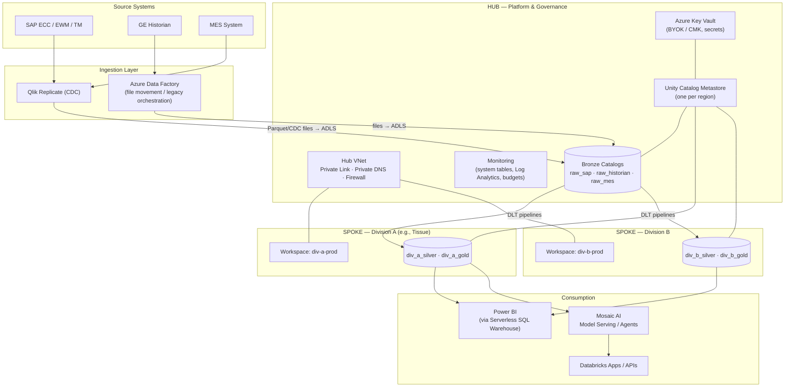
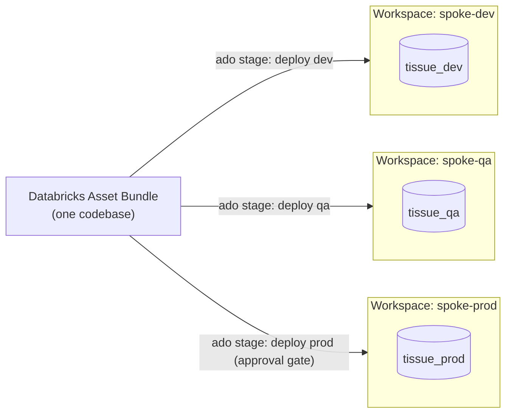
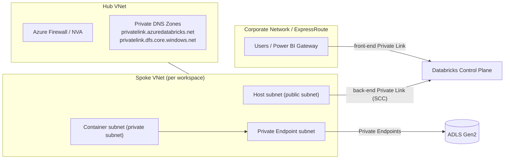
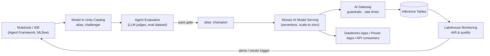
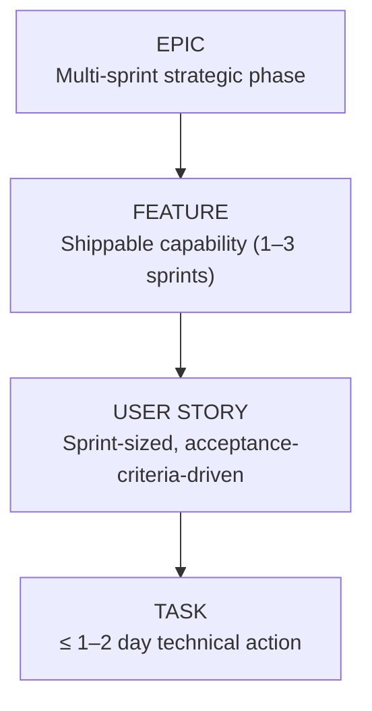

# Azure Databricks Enterprise Implementation — Technical Project Plan

**Version:** 1.0 · **Status:** Draft for Architecture Review Board
**Audience:** Data Engineering, Platform Engineering, Security, BI, and ML teams
**Delivery Model:** Agile (Azure DevOps), Hub-and-Spoke Lakehouse on Unity Catalog

---

## Table of Contents

1. [Current State & Background](#1-current-state--background)
2. [Target Architecture: Hub-and-Spoke Lakehouse](#2-target-architecture-hub-and-spoke-lakehouse)
3. [Workspace & Environment Strategy (Decision Record)](#3-workspace--environment-strategy-decision-record)
4. [Medallion Architecture: Bronze / Silver / Gold](#4-medallion-architecture-bronze--silver--gold)
5. [ETL / ELT Tooling per Layer](#5-etl--elt-tooling-per-layer)
6. [Migrating SQL MI Stored Procedures](#6-migrating-sql-mi-stored-procedures)
7. [Security, Identity & Network Compliance (Zero Trust)](#7-security-identity--network-compliance-zero-trust)
8. [Cost Optimization & Pipeline Automation](#8-cost-optimization--pipeline-automation)
9. [BI & Reporting Layer (Power BI)](#9-bi--reporting-layer-power-bi)
10. [MLOps & Generative AI / Agents](#10-mlops--generative-ai--agents)
11. [Agile Project Structure for Azure DevOps](#11-agile-project-structure-for-azure-devops)
12. [Reference Links & Asset Placeholders](#12-reference-links--asset-placeholders)

---

## 1. Current State & Background

| Domain | Current Implementation | Migration Consideration |
|---|---|---|
| CDC Ingestion | **Qlik Replicate** lands SAP/ERP change data into **ADLS Gen2** and **Azure SQL MI** | Keep Qlik Replicate; repoint/dual-write its ADLS target as the Bronze landing zone. Databricks Auto Loader consumes the landed files. |
| Historian | **GE Historian** exports (typically CSV/Parquet time-series batches) downloaded to ADLS | Ideal Auto Loader source. High-volume, append-only → Bronze streaming tables. |
| MES | MES system pushes transactional data into **SQL MI** | Two options: (a) Lakehouse Federation to query SQL MI in place, (b) Qlik Replicate / ADF incremental copy to ADLS. Prefer (b) long-term to decouple from SQL MI compute. |
| Orchestration | **Azure Data Factory** orchestrates movement into the EDW on SQL MI | ADF remains the *cross-system* orchestrator during transition; **Databricks Workflows / Lakeflow Jobs** become the *in-lakehouse* orchestrator. |
| Transformation | Heavy **T-SQL stored procedures** on SQL MI | Yes — the majority convert cleanly to **Lakeflow Declarative Pipelines (DLT)** and Spark SQL. See [Section 6](#6-migrating-sql-mi-stored-procedures) for the pattern-by-pattern mapping. |
| CI/CD | **Azure DevOps** pipelines, Agile delivery | Extend ADO with Databricks Asset Bundles (DABs) for declarative deploys across environments. |

### Guiding principles

1. **ELT over ETL** — land raw data first (Bronze), transform inside the lakehouse where compute is elastic and versioned.
2. **Unity Catalog is the governance plane** — one metastore per region; all access, lineage, and audit flows through UC, not through workspace-level ACLs.
3. **Everything as code** — infra (Terraform/Bicep), pipelines (DABs + DLT), and RBAC (SCIM + Terraform) are declarative and deployed by ADO.
4. **Serverless first, classic compute by exception** — minimizes idle cost and cluster management overhead.

---

## 2. Target Architecture: Hub-and-Spoke Lakehouse

### 2.1 Concept

The **hub** owns shared governance and platform services: the Unity Catalog metastore, networking (Private Link, DNS), Key Vault, monitoring, and the central ingestion (Bronze) pipelines. Each **spoke** is a division/department slice: its own catalogs (and optionally its own workspace), its own compute policies and budgets, and its own Silver/Gold pipelines — all inheriting hub governance automatically.

Onboarding a new division becomes a repeatable, scriptable act: create catalogs from a template, bind them to the division's workspace(s), assign Entra ID groups, apply a cluster policy and budget. No new networking, no new metastore, no bespoke security review.

### 2.2 Architecture diagram




### 2.3 What lives where

| Concern | Hub | Spoke |
|---|---|---|
| Unity Catalog metastore | ✅ (single, regional) | Consumes via catalog binding |
| Networking (VNets, Private Link, DNS zones) | ✅ hub VNet + peered spoke VNets | Workspace-injected subnets only |
| Encryption keys (BYOK) | ✅ Key Vault, key rotation policy | — |
| Bronze / raw ingestion | ✅ central ingestion team | Read-only access to relevant Bronze schemas |
| Silver / Gold pipelines | — | ✅ owned by division data teams |
| Compute policies & budgets | ✅ defined centrally | Applied per spoke; spokes cannot exceed policy |
| ML endpoints & agents | Shared serving infra optional | ✅ division-scoped models & endpoints |

**Onboarding runbook for a new division (target: < 1 day):**

1. Create Entra ID groups (`grp-divX-engineers`, `grp-divX-analysts`, `grp-divX-admins`) → SCIM-synced to the account console.
2. Terraform module run: creates `divX_dev` / `divX_qa` / `divX_prod` catalogs, storage credentials/external locations on the division's ADLS container, default grants.
3. Bind catalogs to the appropriate workspace(s) (workspace–catalog binding prevents cross-environment access).
4. Apply the standard cluster policy + serverless budget policy tagged `division=divX`.
5. Grant read on required Bronze schemas.

---
## 3. Workspace & Environment Strategy (Decision Record)

### 3.1 The question

Two intertwined decisions:

1. **Per-division isolation:** separate workspace per division vs. shared workspaces with catalog-level isolation?
2. **Environment isolation:** separate workspaces for dev/QA/prod vs. a single workspace with `dev`/`qa`/`prod` catalogs?

### 3.2 Options considered — division isolation

#### Option A: One workspace per division

| Dimension | Assessment |
|---|---|
| Isolation | High — blast radius, compute, notebooks, jobs fully separated |
| Governance | Still centralized (Unity Catalog is account-level, not workspace-level) |
| Cost | Higher ops overhead; no direct infra cost per workspace, but more VNets/subnets to manage with VNet injection |
| Onboarding effort | Medium — Terraform makes it repeatable |
| Chargeback | Easy — usage system tables split cleanly by workspace |

**Pros:** hard compute/network boundaries; per-division admin delegation; noisy-neighbor elimination; simpler compliance narratives ("Division A cannot even see Division B's workspace").
**Cons:** more workspaces to patch/monitor; users in multiple divisions juggle workspaces; subnet IP planning multiplies.

#### Option B: Shared workspace(s), isolation via Unity Catalog only

**Pros:** minimal ops surface; catalogs/schemas + grants provide logical isolation; single pane for platform team.
**Cons:** compute pools, cluster policies, jobs UI, and secrets are workspace-scoped — noisy neighbors and accidental visibility of job names/cluster metadata; harder chargeback; a workspace-level misconfiguration affects everyone.

### 3.3 Options considered — environment isolation

> **Direct answer:** Use **separate workspaces for dev, QA, and prod** — do *not* rely on catalogs alone to separate environments. Use catalogs (`<domain>_dev`, `<domain>_qa`, `<domain>_prod`) *inside* that structure for data separation, with **workspace–catalog binding** so the prod catalog is only visible from the prod workspace.

Why workspaces per environment is the right call:

- **Network & identity posture differs by environment.** Prod gets Private Link front-end restrictions, tighter Conditional Access, no personal compute; dev is looser. These are *workspace-level* settings.
- **CI/CD is cleaner.** Databricks Asset Bundles deploy the *same* bundle to `dev` → `qa` → `prod` workspace targets; promotion is a pipeline stage, not a naming convention.
- **Blast radius.** A runaway dev job cannot exhaust prod compute quotas or pools.
- **Catalog binding closes the loop.** Bind `divA_prod` catalog exclusively to the prod workspace; even a user with grants can't reach prod data from dev.

### 3.4 Decision

**Hybrid hub-and-spoke:**

- **3 workspaces per "delivery unit"** (dev/QA/prod). Start with *one shared delivery unit* (spoke) for smaller divisions and *dedicated spokes* for large/high-compliance divisions. This caps workspace sprawl while preserving hard isolation where it matters.
- **Naming standard: catalog-per-environment, schema-per-layer** — `catalog = <division>_<env>` (e.g., `tissue_dev`, `tissue_qa`, `tissue_prod`), `schema = bronze | silver | gold | ml`, `table = <domain object>`. Combined with workspace–catalog binding, code promotes unchanged while data references resolve per environment via bundle variables.



### 3.5 Consequences

- ✅ Easier SOX/audit story; env promotion is explicit.
- ✅ Divisions can be onboarded as *catalogs first*, upgraded to *dedicated workspaces* later without data movement (data stays in ADLS; only binding changes).
- ⚠️ Platform team must maintain a Terraform workspace factory (subnets, Private Link, SCIM assignment) — budget this as an Epic (see Section 11).

---

## 4. Medallion Architecture: Bronze / Silver / Gold

### 4.1 Purpose of each layer

| Layer | Purpose | Characteristics | Typical Consumers |
|---|---|---|---|
| **Bronze** | Raw, immutable landing of source data *exactly as received* (plus metadata: ingest time, source file, CDC operation) | Append-only; schema-on-read tolerant (rescued data column); retained long-term for replay/audit | Data engineers only |
| **Silver** | Cleansed, conformed, deduplicated, CDC-applied "single source of truth" entities | Enforced schemas & constraints; SCD1/SCD2 applied via `AUTO CDC` / `MERGE`; joins across sources | Data engineers, data scientists, advanced analysts |
| **Gold** | Business-level aggregates, star schemas, KPI marts shaped for consumption | Denormalized/dimensional; optimized for BI query patterns; documented & certified | Power BI, ML feature pipelines, agents, business users |

**Why it matters:** each hop is independently testable and replayable. If a Silver rule changes, you rebuild from Bronze without re-extracting from SAP. If a KPI definition changes, you rebuild Gold without touching Silver.

### 4.2 Compute used per layer

| Layer | Recommended Compute | Why |
|---|---|---|
| Bronze ingestion | **Serverless DLT / Lakeflow Declarative Pipelines** with Auto Loader (continuous or triggered) | Incremental file discovery, checkpointing, schema evolution handled for you; serverless removes idle cost between micro-batches |
| Silver transforms | **Serverless DLT** (default) or **Jobs Compute with Photon** for very large batch joins | Photon accelerates wide joins/aggregations 2–5×; Jobs Compute is ~50% cheaper DBU rate than All-Purpose |
| Gold aggregates | **Serverless DLT / Jobs Compute (Photon)**; materialized views where refresh-incremental | Gold is aggregation-heavy — exactly Photon's sweet spot |
| Ad-hoc dev / exploration | **Serverless notebooks** or small **All-Purpose** clusters with aggressive auto-terminate (≤ 20 min) | All-Purpose is for humans, never for scheduled production jobs |
| BI serving | **Serverless SQL Warehouse** | Instant start, auto-stop, Photon-native (see Section 9) |

### 4.3 How data is typically partitioned / laid out

Modern Databricks guidance has shifted — **default to Liquid Clustering, not Hive-style partitioning**:

- **Bronze:** usually *no partitioning*; ingest date can be a cluster key if tables are large. Auto Loader + Delta handle file compaction (enable Predictive Optimization).
- **Silver:** `CLUSTER BY (business_key, event_date)` — liquid clustering adapts as data skews and doesn't suffer the small-file explosion of `PARTITIONED BY` on high-cardinality columns. Legacy rule of thumb if you must Hive-partition: only on low-cardinality columns (e.g., `ingest_date`) and only when each partition ≥ 1 GB.
- **Gold:** cluster on the dominant BI filter columns (e.g., `plant_id, fiscal_period`). For time-series (GE Historian): cluster by `(tag_id, timestamp_date)`.
- Enable **Predictive Optimization** metastore-wide so OPTIMIZE/VACUUM/clustering maintenance runs automatically — one less job to schedule.

---

## 5. ETL / ELT Tooling per Layer

### 5.1 Loading Bronze (Extract & Land — "EL")

| Tool | Role | Notes |
|---|---|---|
| **Qlik Replicate** | CDC from SAP/MES → ADLS (Parquet + change files) | Already licensed & proven in your estate; keep it. Configure a Bronze landing container per source. |
| **ADF** | File-based movement (GE Historian downloads, SFTP, on-prem shares) | Use Copy Activity → ADLS only; stop using ADF Data Flows for transformation. |
| **Auto Loader (`cloudFiles`)** | ADLS → Bronze Delta tables | Incremental, exactly-once, schema inference + evolution, rescued-data column. The standard entry point into the lakehouse. |
| **Lakehouse Federation** | Query SQL MI in place (no copy) | Transitional: lets Silver pipelines join against MES tables still living in SQL MI during migration. |
| **Lakeflow Connect** | Managed connectors (SQL Server, SaaS sources) | Evaluate as a Qlik alternative for net-new SQL Server sources. |

```python
# Bronze: Auto Loader ingestion (Lakeflow Declarative Pipelines / DLT, Python)
import dlt
from pyspark.sql import functions as F

@dlt.table(name="bronze_ge_historian", comment="Raw GE Historian exports")
def bronze_ge_historian():
    return (
        spark.readStream.format("cloudFiles")
        .option("cloudFiles.format", "parquet")
        .option("cloudFiles.schemaLocation", "/Volumes/hub_prod/bronze/_schemas/ge")
        .option("cloudFiles.inferColumnTypes", "true")
        .load("abfss://landing@<storage>.dfs.core.windows.net/ge_historian/")
        .withColumn("_ingested_at", F.current_timestamp())
        .withColumn("_source_file", F.col("_metadata.file_path"))
    )
```

### 5.2 Loading Silver (Transform — "T")

- **Lakeflow Declarative Pipelines (DLT)** is the default: declarative tables, built-in data quality (`EXPECT` constraints), automatic dependency graph, and `AUTO CDC INTO` (formerly `APPLY CHANGES INTO`) for applying Qlik CDC streams as SCD1/SCD2 — this replaces hand-written `MERGE` boilerplate.
- **Spark SQL / PySpark in Lakeflow Jobs** for logic that doesn't fit DLT (procedural steps, external API calls).
- **dbt on Databricks** is a viable alternative if the team prefers SQL-file-centric workflow; don't run both dbt and DLT for the same domain.

```sql
-- Silver: apply Qlik CDC stream as SCD Type 2 (DLT SQL)
CREATE OR REFRESH STREAMING TABLE silver_material_master;

CREATE FLOW f_material_master AS AUTO CDC INTO silver_material_master
FROM STREAM(bronze_sap_mara)
KEYS (matnr)
SEQUENCE BY _qlik_change_seq
APPLY AS DELETE WHEN _qlik_operation = 'D'
STORED AS SCD TYPE 2;
```

### 5.3 Loading Gold

- **DLT materialized views** for incremental-refresh aggregates (the engine computes only what changed).
- **Lakeflow Jobs (Jobs Compute + Photon)** for heavy dimensional rebuilds.
- **Metric Views / certified datasets** on top of Gold for semantic consistency into Power BI.

### 5.4 Orchestration

- **Databricks Workflows / Lakeflow Jobs** orchestrate everything *inside* the lakehouse (DLT pipelines, notebooks, SQL tasks, dbt) with task dependencies, retries, and alerts.
- **ADF** retains only *cross-system* triggers during transition (e.g., "when Qlik full-load completes, kick the Databricks job" via the ADF Databricks Job activity or REST).
- End-state: ADF shrinks to file-movement + a thin trigger layer; Databricks Workflows own the DAG.

---
## 6. Migrating SQL MI Stored Procedures

### 6.1 Can they be converted to Lakeflow / DLT? — Yes, mostly, and here's the mapping

| T-SQL Pattern | Lakehouse Equivalent | Effort |
|---|---|---|
| `INSERT INTO ... SELECT` staging loads | DLT streaming table / `INSERT INTO` Spark SQL | Low |
| `MERGE` upserts | `AUTO CDC INTO` (DLT) or Delta `MERGE INTO` | Low |
| `UPDATE`/`DELETE` batch corrections | Delta `UPDATE`/`DELETE` (fully supported) | Low |
| Multi-step procs with temp tables (`#tmp`) | CTEs or intermediate DLT tables/`TEMPORARY VIEW`s — each step becomes a named dataset in the pipeline DAG | Medium |
| Cursors / row-by-row loops | Rewrite as set-based Spark SQL or window functions — **do not port loops** | Medium–High |
| Dynamic SQL | Parameterized PySpark building SQL strings, or Jinja via dbt | Medium |
| Scalar UDFs / functions | SQL UDFs / Python UDFs (prefer built-ins; UDFs bypass Photon) | Medium |
| SQL Agent job chains | Lakeflow Jobs with task dependencies | Low |
| Error handling (`TRY/CATCH`, logging tables) | DLT expectations + event log; job-level retries/alerts | Low |
| Cross-database queries to un-migrated tables | Lakehouse Federation to SQL MI | Low (transitional) |

**Practical accelerators:** run procs through the **Databricks SQL migration assistant / `SQLGlot`-based converters or BladeBridge** for a first pass, then manually refactor temp-table chains into DLT dependency graphs. Expect ~70–80% mechanical conversion; the remaining 20–30% (cursors, dynamic SQL) is redesign.

### 6.2 Compute assignment for migrated workloads

| Transformation type | Compute | Rationale |
|---|---|---|
| Continuous CDC apply (Silver) | **Serverless DLT** | Micro-batch efficiency, no idle cost |
| Nightly heavy joins/aggregations | **Jobs Compute + Photon**, autoscaling 2–8 workers | Cheapest DBU class; Photon for join/agg speed |
| Ad-hoc validation during migration | **Serverless notebook** or small All-Purpose (auto-terminate 15 min) | Human-interactive only |
| Backfills / historical replays | **Jobs Compute with spot/preemptible workers** where tolerable | Interruption-tolerant, big savings |
| Post-migration SQL parity testing | **Serverless SQL Warehouse (small)** | Analysts compare SQL MI vs. Gold outputs |

### 6.3 Migration sequence (per domain)

1. **Inventory & classify** procs (pattern table above) → complexity score in ADO backlog.
2. **Shadow-run**: build DLT pipeline in dev writing to `*_dev` catalog; reconcile row counts/checksums vs. SQL MI output nightly.
3. **Cutover** consumers (Power BI datasets, downstream jobs) to Gold tables.
4. **Freeze & retire** the proc; keep SQL MI table read-only for one audit cycle.

---

## 7. Security, Identity & Network Compliance (Zero Trust)

### 7.1 Identity: Entra ID → Unity Catalog RBAC

Azure Databricks uses Entra ID natively (OAuth/OIDC — no separate SAML federation setup is required on Azure, unlike AWS/GCP). Implementation steps:

1. **Account-level SCIM provisioning:** configure the *Azure Databricks SCIM* enterprise application against the **account console** (not per-workspace). Sync *groups*, never individual users.
2. **Group taxonomy (in Entra ID, mastered by IdM):**
   - `grp-dbx-platform-admins` → account admins / metastore admins
   - `grp-dbx-<division>-engineers` → catalog `USE`, schema `CREATE`, pipeline run
   - `grp-dbx-<division>-analysts` → `SELECT` on gold, warehouse usage
   - `grp-dbx-<division>-ml` → model registry + serving endpoints
3. **Unity Catalog grants via Terraform** (idempotent, reviewed in PRs):

```sql
GRANT USE CATALOG ON CATALOG tissue_prod TO `grp-dbx-tissue-analysts`;
GRANT SELECT ON SCHEMA tissue_prod.gold TO `grp-dbx-tissue-analysts`;
GRANT ALL PRIVILEGES ON SCHEMA tissue_prod.silver TO `grp-dbx-tissue-engineers`;
```

4. **Service principals for all automation** (ADO deploys, jobs run-as). Use **federated identity credentials / workload identity federation** from ADO → Entra ID → Databricks so no client secrets are stored in pipelines.
5. **Conditional Access:** require compliant device + MFA for the Databricks first-party app; block legacy auth. Scope stricter policies to the prod workspace URL.
6. **Fine-grained controls:** row filters & column masks in UC for PII; `dynamic view`s only where masks don't fit.

### 7.2 Data at rest: BYOK / Customer-Managed Keys

Azure Databricks supports CMK in three scopes — implement all three for a complete story:

1. **Managed services CMK** (notebooks, secrets, job metadata in the control plane): create an RSA key in **Azure Key Vault (or HSM)**, grant the Databricks-managed identity `get/wrapKey/unwrapKey`, set the key on the workspace (Premium tier required).
2. **Managed disks CMK**: encrypts compute VM disks; configure a disk-encryption-set-backed key with auto-rotation enabled.
3. **Storage CMK (your data)**: ADLS Gen2 accounts (Bronze/Silver/Gold containers + workspace root/DBFS storage) configured with CMK from the hub Key Vault. Enable **key auto-rotation** and soft-delete/purge protection on the vault (mandatory).

Terraform the whole chain (Key Vault → key → access policy/RBAC → workspace/storage attachment) so key rotation and audits are declarative.

### 7.3 Network: VNet injection + Private Link



Implementation steps:

1. **VNet injection:** deploy each workspace into a customer VNet with two delegated subnets (host + container). Size subnets for max concurrent cluster nodes (e.g., /23 + /23 for large spokes) — this cannot be resized later without workspace redeploy.
2. **Secure Cluster Connectivity (NPIP):** enabled — no public IPs on cluster nodes.
3. **Back-end Private Link:** private endpoint from the workspace subnets to the Databricks control plane (relay + REST API).
4. **Front-end Private Link:** private endpoint for user/API access; set *public network access = disabled* on prod and force all access through ExpressRoute/VPN. Keep a browser-auth private endpoint for SSO callback.
5. **Storage:** private endpoints (`dfs`, `blob`) to every ADLS account; disable public access on the accounts; UC storage credentials use access-connector managed identities.
6. **Egress control:** route container-subnet egress through Azure Firewall; allow-list only required FQDNs (control plane, artifact/log storage, pypi mirror if permitted). Consider the Databricks serverless egress control / network policies for serverless compute.
7. **Serverless compute connectivity:** configure **Network Connectivity Configurations (NCC)** with private endpoints so *serverless* warehouses/pipelines also reach your ADLS privately.

---

## 8. Cost Optimization & Pipeline Automation

### 8.1 Should ADO pipelines start/stop clusters directly? — Generally **no**

Starting/stopping *classic clusters* imperatively from ADO pipeline steps is an anti-pattern for routine workloads:

- It reimplements what the platform already does natively (job clusters are **ephemeral by design** — created on job start, terminated on completion).
- It couples infrastructure lifecycle to a CI tool that has no visibility into query load, retries, or autoscaling signals.
- It creates failure modes where a canceled ADO run leaks a running cluster (cost) or kills a cluster mid-write (correctness).

**What ADO *should* do:** deploy code and definitions (Databricks Asset Bundles: jobs, DLT pipelines, warehouse configs) and *trigger* runs. **What Databricks should do:** own compute lifecycle via job clusters, serverless, autoscaling, and auto-terminate.

Legitimate exceptions: warming a named SQL Warehouse right before a scheduled mass Power BI refresh, or stopping dev All-Purpose clusters on a nightly cleanup schedule — fine as small housekeeping jobs (better via Databricks scheduled job or cluster policy auto-terminate than ADO).

### 8.2 Cost strategy checklist

| Strategy | Mechanism |
|---|---|
| Serverless by default | Serverless DLT, serverless jobs, serverless SQL warehouses — pay per use, zero idle |
| Job clusters, never All-Purpose, for scheduled work | ~50% lower DBU rate; enforce via **cluster policy** (`"cluster_type": "job"` allowed list) |
| Photon on transformation compute | Fewer nodes / shorter runtimes on joins & aggregations |
| Autoscaling + auto-terminate enforced by policy | Policies set max workers, mandatory `autotermination_minutes ≤ 20` for interactive |
| Spot instances for fault-tolerant batch | Backfills, non-SLA jobs; driver on-demand, workers spot |
| Tag everything | Policies inject `division`, `env`, `cost_center` tags → Azure Cost Mgmt + system tables chargeback |
| Budgets & alerts | Databricks **budget policies** on serverless + account budgets; Azure cost alerts per RG |
| Watch the system tables | `system.billing.usage` dashboards per division; weekly FinOps review |
| Predictive Optimization | Avoids hand-scheduled OPTIMIZE/VACUUM jobs burning compute |

---

## 9. BI & Reporting Layer (Power BI)

### 9.1 Recommended pattern

**Power BI → Serverless SQL Warehouse → Unity Catalog Gold** with Entra ID SSO passthrough.

- **Import mode** for most curated Gold marts (best report latency; refresh hits the warehouse briefly).
- **DirectQuery / composite** for large fact tables or near-real-time operational reports (Historian/MES telemetry).
- **Publish to Power BI** semantic models directly from Unity Catalog where useful (Databricks → Power BI task), keeping model schema in sync with Gold.

### 9.2 Keep a warehouse running 24/7? — No

Use a **Serverless SQL Warehouse** with:

- **Auto-stop ≈ 10 minutes** (serverless cold start is seconds, so aggressive auto-stop is safe — unlike classic warehouses with multi-minute starts).
- **Autoscaling clusters (min 1 / max N)** sized for concurrency, not data volume; scale-out handles Monday-morning dashboard storms.
- **Scheduled Import refreshes** batched into windows (e.g., 05:30–06:30) so one warm warehouse serves all refreshes, then stops.
- Separate **small warehouse for ad-hoc analysts** vs. **refresh warehouse for scheduled loads** — isolates BI SLAs from exploration.
- Result caching + Photon are built-in on serverless; Gold tables liquid-clustered on report filter keys do the rest.

Only consider an always-on classic warehouse if procurement blocks serverless in your region — then use a Small with auto-stop 15–30 min and accept warm-up on first query.

---

## 10. MLOps & Generative AI / Agents

### 10.1 Tooling map (what you need to build models, endpoints, and agents)

| Capability | Databricks Tooling |
|---|---|
| Experiment tracking | **MLflow** (managed) — runs, params, metrics, artifacts |
| Model registry & lineage | **Models in Unity Catalog** (versioned, governed, cross-workspace shareable) |
| Feature management | **Feature Engineering in UC** (feature tables + online tables for low-latency lookup) |
| Training compute | ML Runtime clusters (GPU where needed); serverless GPU as available |
| Batch inference | `ai_query()` / Spark batch scoring in Lakeflow Jobs |
| Real-time inference | **Mosaic AI Model Serving** — serverless endpoints, scale-to-zero, A/B traffic splitting |
| LLM access | **Foundation Model APIs** (pay-per-token), **External Models** (Azure OpenAI, Anthropic via AI Gateway) |
| Agent development | **Mosaic AI Agent Framework** (+ MLflow `ResponsesAgent`), Unity Catalog **functions as tools**, Vector Search for RAG |
| Agent/LLM evaluation | **Mosaic AI Agent Evaluation** + MLflow evaluation datasets, LLM judges |
| Guardrails, rate limits, logging | **Mosaic AI Gateway** on serving endpoints |
| Request/response capture | **Inference tables** (auto-logged to Delta — feeds monitoring & retraining) |
| Monitoring | **Lakehouse Monitoring** on inference tables (drift, quality) |
| App surface | **Databricks Apps** or external apps hitting serving endpoints via REST |

### 10.2 Deployment & compute management strategy

1. **Everything registered in UC:** `tissue_prod.ml.demand_forecast@champion` — aliases (`champion`/`challenger`) drive promotion instead of hardcoded versions.
2. **CI/CD via DABs + ADO:** training pipeline (Lakeflow Job) and serving endpoint config are bundle resources; ADO stages: train in dev → evaluate gate (metrics threshold) → register → promote alias → deploy endpoint to prod workspace.
3. **Endpoints are serverless with scale-to-zero** for spiky internal workloads; set min provisioned concurrency > 0 only for latency-SLA endpoints.
4. **Batch vs. real-time decision rule:** if consumers read predictions from a table on a schedule → batch (`ai_query` in a job, cheapest). Only stand up an endpoint when an app/agent needs sub-second responses.
5. **Agents:**
   - Tools = **UC functions** (SQL/Python) so governance and audit apply to what the agent can *do*.
   - RAG = **Vector Search index** over Gold/curated docs (synced from Delta).
   - Author with **Agent Framework / LangGraph in Python**, log as MLflow model, evaluate with Agent Evaluation, deploy to Model Serving with **AI Gateway** guardrails + inference tables enabled.
   - Human feedback loop: review app → labeled traces → evaluation dataset → regression-test every agent release in ADO.



---
## 11. Agile Project Structure for Azure DevOps

### 11.1 Hierarchy overview



### 11.2 Epic catalog

| # | Epic | Outcome |
|---|---|---|
| E1 | **Platform Foundation & Landing Zone** | Terraform-provisioned hub + dev/qa/prod workspaces, VNet injection, Private Link, CMK |
| E2 | **Security, Identity & Governance** | SCIM groups, UC RBAC model, catalog binding, row/column controls, audit dashboards |
| E3 | **Core Ingestion (Bronze)** | Qlik/ADF landing zones + Auto Loader pipelines for SAP, GE Historian, MES |
| E4 | **EDW Migration (Silver/Gold)** | Stored-proc conversion to DLT, parity validation, SQL MI consumer cutover |
| E5 | **BI Enablement** | Serverless SQL Warehouses, Power BI SSO, certified Gold semantic models |
| E6 | **CI/CD & DataOps** | DABs, ADO multi-stage pipelines, env promotion with approvals, testing framework |
| E7 | **MLOps & GenAI Track** | UC model registry workflow, serving endpoints, first production agent with evaluation |
| E8 | **FinOps & Observability** | Cluster/budget policies, tagging, system-table chargeback dashboards, alerting |

### 11.3 Worked example — one thread through the hierarchy

**Epic (E3): Core Ingestion — Bronze Layer**
> *Description:* Establish governed, incremental, replayable ingestion of all three source systems into Bronze Delta tables under Unity Catalog, replacing direct-to-EDW loads. Success = 100% of in-scope tables landing with < 15-min latency (CDC) / per-schedule (batch), with lineage visible in Catalog Explorer.

**Feature (under E3): GE Historian ingestion via Auto Loader**
> *Description:* Continuous ingestion of GE Historian time-series exports from the ADLS landing container into `hub_prod.bronze.ge_historian_*` streaming tables with schema evolution, quarantine handling, and monitoring. Includes backfill of 24 months of history.

**User Story:**
> *As a* data engineer, *I want* GE Historian files landing in ADLS to be automatically ingested into a Bronze Delta table via Auto Loader inside a DLT pipeline, *so that* downstream Silver pipelines consume governed, incremental data instead of raw files.
>
> **Acceptance Criteria:**
> 1. New files in `abfss://landing/.../ge_historian/` appear in `bronze_ge_historian` within 10 minutes (triggered mode, 5-min schedule).
> 2. Schema drift adds new columns without pipeline failure; unparsable records land in `_rescued_data`.
> 3. Table records `_ingested_at` and `_source_file` metadata columns.
> 4. Pipeline deployed via Databricks Asset Bundle from the ADO repo — no manual UI edits.
> 5. Failure alert routed to the `#data-platform-alerts` channel within 5 minutes.

**Tasks (under that story):**
1. Create external location + storage credential for the landing container (Terraform PR).
2. Author DLT pipeline notebook/`.py` with Auto Loader source and metadata columns.
3. Add pipeline resource to the asset bundle (`resources/pipelines/ge_historian.yml`) with dev/qa/prod targets.
4. Configure ADO stage to `databricks bundle deploy -t qa` on merge to `main`.
5. Write pytest + DLT expectation checks (row-count > 0, no null `tag_id`).
6. Set up job failure notification destination and alert rule.
7. Run 24-month backfill in qa; reconcile counts vs. source extract manifest; document in wiki.

### 11.4 Import into ADO

Maintain the backlog as CSV/YAML in the repo and bulk-import (Boards → Import Work Items), or script it against the ADO REST API (`workitemtracking/workitems`) with a Python service connection — consistent with the everything-as-code principle.

---

## 12. Reference Links & Asset Placeholders

### Diagrams to render/export

- 
- 
- 
- 

### Documentation

- [Unity Catalog best practices](https://learn.microsoft.com/azure/databricks/data-governance/unity-catalog/best-practices)
- [Lakeflow Declarative Pipelines (DLT)](https://learn.microsoft.com/azure/databricks/dlt/)
- [Auto Loader](https://learn.microsoft.com/azure/databricks/ingestion/cloud-object-storage/auto-loader/)
- [AUTO CDC / APPLY CHANGES](https://learn.microsoft.com/azure/databricks/dlt/cdc)
- [VNet injection](https://learn.microsoft.com/azure/databricks/security/network/classic/vnet-inject)
- [Azure Private Link for Databricks](https://learn.microsoft.com/azure/databricks/security/network/classic/private-link)
- [Customer-managed keys (BYOK)](https://learn.microsoft.com/azure/databricks/security/keys/customer-managed-keys)
- [SCIM provisioning from Entra ID](https://learn.microsoft.com/azure/databricks/admin/users-groups/scim/)
- [Databricks Asset Bundles](https://learn.microsoft.com/azure/databricks/dev-tools/bundles/)
- [Serverless SQL Warehouses](https://learn.microsoft.com/azure/databricks/compute/sql-warehouse/serverless)
- [Mosaic AI Agent Framework](https://learn.microsoft.com/azure/databricks/generative-ai/agent-framework/build-genai-apps)
- [Mosaic AI Model Serving](https://learn.microsoft.com/azure/databricks/machine-learning/model-serving/)
- [Inference tables](https://learn.microsoft.com/azure/databricks/machine-learning/model-serving/inference-tables)
- [Liquid clustering](https://learn.microsoft.com/azure/databricks/delta/clustering)
- [Budget policies & system tables](https://learn.microsoft.com/azure/databricks/admin/usage/)

---

*End of document. Feed individual sections into the ADO wiki or split per-Epic as delivery begins.*
